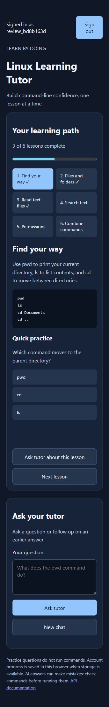

# Linux Learning Tutor

A local Linux learning app built with FastAPI, HTML/CSS/JavaScript, and Ollama
running llama3.2. No frontend build step or API key is required.

[View the login page](docs/screenshots/login.jpg)

## Features
- SQLite-backed registration and login with Argon2id password hashing.
- Expiring cookie sessions, CSRF checks, and login rate limits.
- Six guided lessons: navigation, files, reading text, search, permissions, pipes.
- Practice quizzes with immediate feedback.
- Completion progress saved in browser local storage when available.
- Streamed AI answers and follow-up questions using the last six exchanges.
- New chat button and interactive API documentation at /docs.

## Setup (Ubuntu / WSL)
Install Python 3, its venv package, and Ollama from https://ollama.com.
Clone this repository and run:

~~~bash
cd linux-learning-tutor
python3 -m venv backend/venv
source backend/venv/bin/activate
python -m pip install -r backend/requirements.txt
ollama pull llama3.2
~~~

Ollama must be running. If installed as a systemd service, use:

~~~bash
sudo systemctl start ollama
~~~

Otherwise run ollama serve in a separate terminal.

## Run
~~~bash
chmod +x start.sh
./start.sh
~~~

Keep the terminal open. Visit http://localhost:8000 and create an account.
Usernames use letters, numbers, or underscores. Use a unique passphrase
of at least 15 characters. Returning users can sign in.
Press Ctrl+C to stop the web app. Ollama runs separately.

## Demo
1. Answer the navigation quiz with cd ..
2. Open another lesson and observe updated progress.
3. Refresh to confirm progress persists.
4. Click Ask tutor about this lesson, then Ask tutor.
5. Ask a follow-up question.
6. Click New chat to clear chat memory.

## API
- GET / serves the learning interface.
- POST /auth/register and POST /auth/login create sessions.
- GET /auth/me returns account info and the CSRF token.
- POST /auth/logout revokes the current session.
- POST /ask returns a JSON answer.
- POST /ask/stream returns newline-delimited JSON token events, ending with
  a done event; failures use an error event.
- GET /docs provides interactive API documentation.

~~~json
{"question": "What does pwd do?", "history": []}
~~~

History accepts user and assistant messages only, up to 12 messages.
Questions are limited to 4,000 characters. Tutor POST requests require a
session cookie, a matching Origin header, and the X-CSRF-Token returned
by /auth/me. API documentation is public; model access is authenticated.

## Troubleshooting
- Page cannot be reached: run ./start.sh and keep its terminal open.
- Port 8000 in use: use the existing app or stop it with Ctrl+C first.
- Ollama unavailable: run ollama list and check its service.
- Model missing: run ollama pull llama3.2.
- Slow first answer: model loading and CPU inference take time.
  Streaming displays text as it is generated.

## Scope
This local learning prototype does not execute commands. AI answers can be
inaccurate. Chat clears on refresh; progress is local to the browser.
Accounts are stored locally in SQLite; there is no hosted deployment.
The startup script binds to loopback (127.0.0.1) for local use.

## Architecture

~~~text
Browser (lessons, quizzes, local progress, recent chat)
       |
       | HTTP requests / streamed NDJSON
       v
FastAPI (validation, tutor instructions, error handling)
       |
       | Local Ollama chat API
       v
Ollama + llama3.2 (local inference)
~~~

Fixed lesson quizzes work without model inference once the page loads.
SQLite stores account hashes, session hashes, and rate-limit counters.
The browser sends up to six completed exchanges with each question.
The backend prepends tutor instructions and streams text back.
A completion event marks a successful answer; errors do not enter chat memory.

## Automated tests

Tested with Python 3.12. From the repository root:

~~~bash
backend/venv/bin/python -m unittest discover -s backend/tests -v
~~~

The 31 automated API and authentication tests use a mocked Ollama client. They cover question validation,
history ordering, answer generation, streaming completion, interrupted
responses, service failures, model failures, and page/documentation routes.
They do not measure answer quality or replace browser testing.
No running Ollama service is required for these tests.

## Portfolio demo and release
- [90-second demo script and interview notes](docs/DEMO.md)
- [Release checklist](docs/RELEASE_CHECKLIST.md)
- [Draft release notes](docs/RELEASE_NOTES.md)

Record a real demo and verify repository visibility before sharing the
project with recruiters. This repository does not yet include a demo video.

## License
See [LICENSE](LICENSE).

## Account security and SQL storage

The database is created automatically at backend/data/tutor.sqlite3 and is
excluded from Git. The application creates it with owner-only file permissions.
Never commit databases, their backups, session cookies, or passwords.

- Passwords: salted Argon2id (19 MiB memory, 2 iterations, 1 lane).
- Minimum registration password length: 15 characters; maximum: 128.
- SQL: parameterized queries, unique normalized usernames, foreign keys.
- Sessions: random 256-bit tokens; only SHA-256 token hashes stored in SQL.
- Cookies: HttpOnly and SameSite=Strict; eight-hour absolute expiry.
- Logout deletes the server session; signing in rotates the current token.
- State changes: same-origin checks and session-bound CSRF headers.
- Login: generic failure responses and persistent 15-minute rate limits.
- Browser: strict CSP on the app and login, frame protection, no-store responses.
  Swagger documentation separately allows its existing CDN assets.
- Lesson progress is separated by username in browser storage; it is not SQL-backed.

### Before internet deployment
Local HTTP is for loopback development only. Set TUTOR_SECURE_COOKIES=1 behind
an HTTPS reverse proxy, and set TUTOR_ALLOWED_HOSTS to your actual hostname.
Example environment variables (export them before starting the server):

~~~bash
export TUTOR_SECURE_COOKIES=1
export TUTOR_ALLOWED_HOSTS=tutor.example.com
~~~

Do not set Secure cookies on a plain HTTP deployment. Configure the proxy to
preserve the correct host and scheme, trust only its actual address, disable
the development reloader, and keep Ollama private. Add backups with restricted
access, monitoring, password recovery, and any needed account administration
before operating a public service. Current rate limits use the real peer IP;
behind a proxy they may apply to all users sharing that proxy.
There is no email verification, MFA, password reset, or independent security audit.

References:
- [OWASP password storage](https://cheatsheetseries.owasp.org/cheatsheets/Password_Storage_Cheat_Sheet.html)
- [OWASP session management](https://cheatsheetseries.owasp.org/cheatsheets/Session_Management_Cheat_Sheet.html)
- [OWASP CSRF prevention](https://cheatsheetseries.owasp.org/cheatsheets/Cross-Site_Request_Forgery_Prevention_Cheat_Sheet.html)
